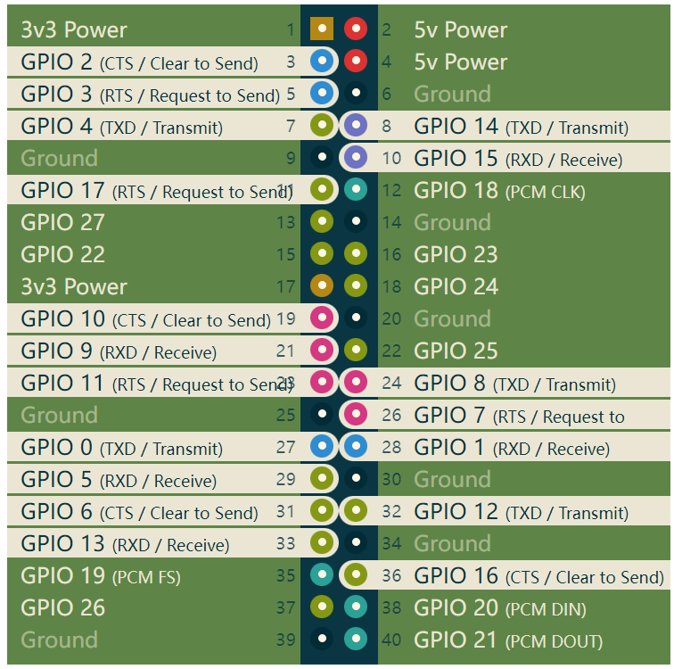

##  电鼠——主控板应用

电鼠的上层应用基于ROS2-Humble版本。可以使用树莓派4B或兼容树莓派4B结构的其他开发板作为主控板。

### 硬件/系统支持

除了原生支持ROS2的Ubuntu之外，生肖系列机器人支持[OpenEuler开源操作系统](https://www.openeuler.org/zh/)。与[ROS-sig](https://www.openeuler.org/zh/sig/sig-detail/?name=sig-ROS)合作，使用社区移植的ROS2软件栈作为基础。目前支持的主控板包括基于RK3588的coolpi4B和树莓派4B。

| 板载计算机*                                   | 操作系统                     | ROS环境                                  | 生肖Robot ROS应用部署方式                      |
| --------------------------------------------- | :--------------------------- | ---------------------------------------- | ---------------------------------------------- |
| [树莓派4B](https://www.raspberrypi.com/)      | OpenEuler22.03-SP2           | 基于OpenEuler社区软件源安装的ROS2-Humble | ROS源码编译/<br/>RPM软件源二进制安装（开发中） |
|                                               | ubuntu22.04                  | 基于ROS软件源安装的ROS-Humble            | ROS源码编译                                    |
| [RK3588-Coolpi4B](https://forum.cool-pi.com/) | OpenEuler22.03-SP2（开发中） | 基于OpenEuler社区软件源安装的ROS2-Humble | ROS源码编译/<br/>RPM软件源二进制安装（开发中） |
|                                               | ubuntu22.04                  | 基于ROS软件源安装的ROS-Humble            | ROS源码编译                                    |

*注：后文中可能提的主控板/板载计算机/单板计算机/上位机均指同一概念*

### 镜像烧录&安装ROS

#### 在树莓派4B安装Ubuntu22及ROS-humble

- **烧录Ubuntu22镜像**

  参考文档：https://ubuntu.com/download/raspberry-pi

- **安装ROS**

  参考文档：https://docs.ros.org/en/humble/Installation/Ubuntu-Install-Debians.html

#### 在树莓派4B安装OpenEuler22.03SP2及ROS-humble

- **烧录OpenEuler22.03 SP2镜像**

  参考文档：[在树莓派上安装Openeuler22.03SP2](https://docs.openeuler.org/zh/docs/22.03_LTS_SP2/docs/Installation/%E5%AE%89%E8%A3%85%E5%87%86%E5%A4%87-1.html) 

  镜像地址：https://repo.openeuler.org/openEuler-22.03-LTS-SP2/raspi_img/openEuler-22.03-LTS-SP2-raspi-aarch64.img.xz

  默认用户名：**root**；默认密码：**openeuler**

  *注：不推荐正常情况下使用root用户登录，但是不确定pi用户的默认密码。可以在第一次使用root登录，并使用`passwd pi`更改用户pi的密码，之后使用用户pi登录。*

- **[安装ROS](https://docs.openeuler.org/zh/docs/22.03_LTS_SP2/docs/ROS/%E5%AE%89%E8%A3%85%E4%B8%8E%E9%83%A8%E7%BD%B2.html)**

  执行以下操作，从openEuler软件源中安装ROS-humble。
  
  ```
  #安装openeuler的ROS源
  dnf install openeuler-ros 
  dnf install ros-humble-ros-base 
  ```
  
  
  *注：如遇到网络问题无法正常下载，下载进度缓慢，可以使用YUM镜像源：https://www.openeuler.org/zh/mirror/list/，换源操作可在网上搜索。如果已经安装了openeuler-ros，还需要对ros的yum源文件一并换源*
  
  之后在OpenEuler安装ROS与Ubuntu的包名是基本一致的。
  
### 电鼠ROS应用编译部署

#### 在Ubuntu22中编译部署ROS应用

无特殊要求，与正常ROS包编译过程相同。

- **创建ROS工作空间**

```
mkdir dianshu
cd dianshu
```

- **clone仓库**

```
git clone https://gitee.com/shengxiaorobot/sheng-xiao-robot_-dian-shu_-ros.git
```

- **colcon构建**

```
colcon build
```

#### 在OpenEuler22.03SP2中部署电鼠ROS应用

前提：已烧录OpenEuler22.03-SP2，并安装好ros-humble-ros-base环境为背景

- **安装依赖**

```
dnf install cmake make gcc gcc-g++ git gstreamer1*
pip3 install colcon-common-extensions pyserial numpy-quaternion
```

*注：openeuler中如果安装失败尝试使用root权限*

- **创建ROS工作空间**

```
mkdir dianshu
cd dianshu
```

- **clone仓库**

```
git clone https://gitee.com/shengxiaorobot/sheng-xiao-robot_-dian-shu_-ros.git
```

- **colcon构建**

```
colcon build
```

### 电鼠ROS应用指南

#### 软件结构

```
├──dianshu_base 				#下位机驱动
├──dianshu_example_apriltag		#一个识别Apriltag并调用摄像头云台的example
├──dianshu_nav					#Nav2与SLAM算法的启动和配置包
└──sllidar_ros2					#思岚雷达驱动
```

#### 系统配置(树莓派)

由于电鼠需要使用两个串口(雷达、下位机)，而树莓派默认仅开放一个串口，需要手动配置config.txt来启用其他串口。同时还需要修改cmdline设置第一个串口不再是debug口。

本方案在所有较新的树莓派镜像(openEuler/Ubuntu/PiOS)中均适用。旧版树莓派镜像(Raspbian)可能不适用。

这里以openEuler为例，应当也适用ubuntu22和pPiOS

- **检查树莓派串口**

  执行 `ls /dev/tty*`查看是否存在ttyAMA\*或者ttyS\*。此时应当有ttyAMA0，表示Uart0已经启用。

  观察40pin上的串口分布，我们至少需要使用两个串口。**那么使用UART0(gpio14/15)和UART2(gpio7/8)**

  

- **配置debug口**

  默认情况下uart0是作为debug口的，不能正常连接外设，需要取消掉debug口功能。

  找到cmdline.txt，在不同的系统镜像中实际起作用的cmdline可能并不相同。openeuler下为/boot/cmdline.txt

  编辑cmdline.txt，删除`console=serial0,115200 console=tty1`并重启。

  当然如果需要使用debug口，也可以配置到其他串口上，或者不使用该串口连接外设。

- **启用uart2**

  找到实际起作用的config.txt，在openeuler下为/boot/config.tx。

  在末尾添加：

  ```
  dtoverlay=uart2 	
  ```

  之后重启板子。如果没有问题，重启之后会看到除了原有的ttyAMA0，还多了一个ttyAMA1(也可能是ttyAMA2)，反正是**多了一个串口设备，并且两个串口都能正常通信。**

  *dtoverlay的机制参考：https://www.raspberrypi.com/documentation/computers/configuration.html#configuring-uarts。网络上已有的树莓派uart配置资料大部分都是旧系统(raspbian)的，在新系统中(基于pios新内核的)基本不适用了。*

- **线路连接**

  将雷达和下位机的串口通过杜邦线连接到树莓派UART0(gpio14/15)和UART2(gpio7/8)，并记住哪个串口连接的是哪个设备，后续可能需要修改launch文件以匹配串口号。

  打开launch文件：`dianshu_base/launch/robot_bringup_launch.py`。这个launch文件包含了雷达驱动和下位机驱动。也是其他高级应用启动时会附带启动的launch。
  检查以下两个参数以及其中的串口号配置与你实际使用的串口是否一致：

  - **雷达串口号sl_lidar_serial_port_launch_arg**

        sl_lidar_serial_port_launch_arg = DeclareLaunchArgument(
            "serial_port",
            default_value="/dev/ttyAMA0",  # rasp uart0
            description="Specifying usb port to connected lidar",
        )

  - **下位机串口号lower_mcu_serial_port_arg****

    ```
    lower_mcu_serial_port_arg = DeclareLaunchArgument(
            "lower_mcu_serial_port",
            default_value="/dev/ttyAMA1",  # rasp uart2
            description="Specifying usb port to connected servo",
        )
    ```

#### ROS应用

- **启动底盘驱动+雷达**

```
ros2 launch dianshu_base robot_bringup_launch.py
```

启动无误后，会发布odom->base_link的tf以及/odom、/laser、/imu/data_raw话题。并接受/cmd_vel话题发布的速度信息。

IMU 协议、标定参数、安装 TF 和 EKF 接入注意事项见 [底盘与 IMU 说明](dianshu_base/README.md)。

Nav2 必须同时具备底盘里程计和雷达定位数据。没有下位机或雷达时，不能进行真实导航；
可用 `use_fake_base:=true`、`use_lidar:=false` 仅检查软件节点链路。

- **基于SLAMtoolbox的建图**

注：本仓库没有使用Cartographer

```
ros2 launch dianshu_nav mapping_launch.py
```

保存地图：

```
ros2 run nav2_map_server map_saver_cli -f <map_name>
```

- **建图时导航**

```
ros2 launch dianshu_nav nav2_online_slam_launch.py
```

- **nav2导航**

注：这里需要在nav2_launch.py中指明使用的地图名， 并将地图放置于dianshu_nav/maps下，并colcon编译。

```
ros2 launch dianshu_nav nav2_launch.py
```

### 开发计划

✅已完成 😼正在进行 📅计划进行

| 计划说明                                               | 完成状态 |
| ------------------------------------------------------ | -------- |
| 底层驱动基本实现                                       | ✅        |
| 考虑采取NAV2的建议，将底层驱动更换为ros_controller框架 | 📅        |
| 优化雷达畸变                                           | 📅        |
| NAV/SLAM系列launch文件                                 | ✅        |
| NAV参数基本版                                          | ✅        |
| 有图导航下的NAV参数调优                                | ✅        |
| 无图导航下的NAV参数调优                                | ✅        |
| 新写一些行为树插件，以满足后续摄像头功能的应用         | 📅        |
| slamtoolbox参数基本版                                  | ✅        |
| 树莓派摄像头libcamera驱动                              | ✅        |
| 树莓派摄像头v4l2驱动                                   | ✅        |
| 基于v4l2-camera的摄像头ros层驱动                       | 📅        |
| 基础的Apirltag识别                                     | ✅        |
| 带有参数的apirltag_ros的识别                           | 📅        |
